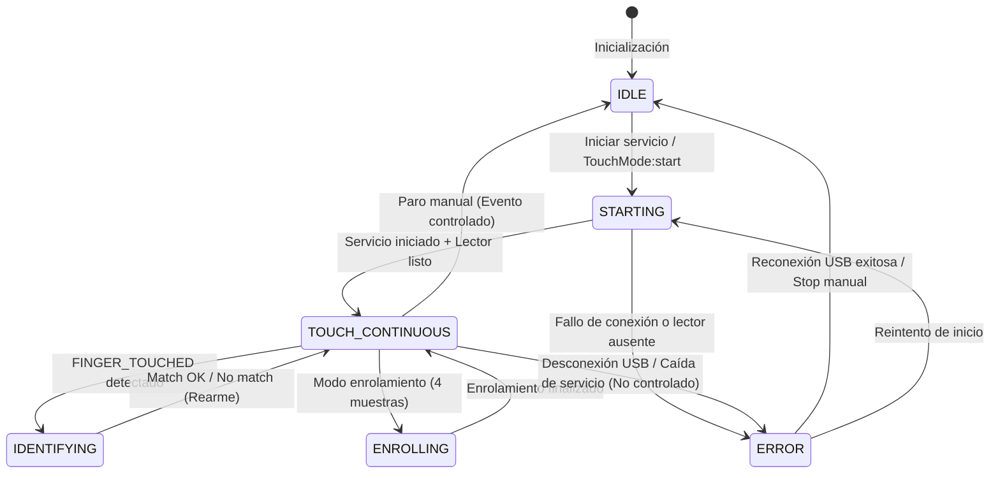

# Diagramas de Flujo - Sistema de Captura Continua

> Contrato de eventos (hook edge-js + SSE `GET /events`): **[CONTRATO-EVENTOS-MOTOR-BIOMETRICO.md](./CONTRATO-EVENTOS-MOTOR-BIOMETRICO.md)**.

## Diagrama de Secuencia Completo

```
┌─────────┐  ┌────────────┐  ┌──────────────┐  ┌───────────┐  ┌─────────────┐  ┌──────────┐
│ Usuario │  │  Hardware  │  │ BiometricCore│  │ server.js │  │TouchMode    │  │  app.js  │
│         │  │  DP4500    │  │    (C#)      │  │ (Node.js) │  │Service (TS) │  │  (UI)    │
└────┬────┘  └─────┬──────┘  └──────┬───────┘  └─────┬─────┘  └──────┬──────┘  └────┬─────┘
     │             │                │                 │                │              │
     │             │                │◄────────────────┤                │              │
     │             │                │ StartTouchMode()│                │              │
     │             │                │                 │                │              │
     │             │                │─────────────────┤                │              │
     │             │                │   OK, started   │                │              │
     │             │                │                 │                │              │
     │             │◄───────────────┤                 │                │              │
     │             │ Subscribe to   │                 │                │              │
     │             │ finger events  │                 │                │              │
     │             │                │                 │                │              │
     │   [Coloca   │                │                 │                │              │
     │    dedo]    │                │                │                 │              │
     │─────────────►                │                │                 │              │
     │             │                │                │                 │              │
     │             │────OnFingerTouch()              │                 │              │
     │             │───────────────►│                │                 │              │
     │             │                │                │                 │              │
     │             │                │ FINGER_TOUCHED │                 │              │
     │             │                │────────────────►                 │              │
     │             │                │                │                 │              │
     │             │                │                │ SSE: FINGER_    │              │
     │             │                │                │      TOUCHED    │              │
     │             │                │                │─────────────────►              │
     │             │                │                │                 │              │
     │             │                │                │                 │SSE Event:    │
     │             │                │                │                 │FINGER_TOUCHED│
     │             │                │                │                 │──────────────►
     │             │                │                │                 │              │
     │             │◄───────────────┤                │                 │              │
     │             │ Capture image  │                │                 │              │
     │             │────────────────►                │                 │              │
     │             │  Image data    │                │                 │              │
     │             │                │                │                 │              │
     │             │                │ IMAGE_CAPTURED │                 │              │
     │             │                │────────────────►                 │              │
     │             │                │                │ SSE: IMAGE_     │              │
     │             │                │                │      CAPTURED   │              │
     │             │                │                │─────────────────►              │
     │             │                │                │                 │              │
     │             │                │ Create FMD     │                 │              │
     │             │                │───────┐        │                 │              │
     │             │                │       │        │                 │              │
     │             │                │◄──────┘        │                 │              │
     │             │                │                │                 │              │
     │             │                │FINGERPRINT_READY                │              │
     │             │                │────────────────►                 │              │
     │             │                │                │ SSE:FINGERPRINT_│              │
     │             │                │                │      READY      │              │
     │             │                │                │─────────────────►              │
     │             │                │                │                 │              │
     │             │                │                │                 │SSE Event:    │
     │             │                │                │                 │FINGERPRINT_  │
     │             │                │                │                 │   READY      │
     │             │                │                │                 │──────────────►
     │             │                │                │                 │              │
     │             │                │                │                 │              │
     │             │                │                │                 │identifyAnd   │
     │             │                │                │                 │Register()    │
     │             │                │                │◄────────────────┤              │
     │             │                │                │ POST /api/touch/│              │
     │             │                │                │  identify-last  │              │
     │             │                │                │                 │              │
     │             │                │ IdentifyLastCaptured()           │              │
     │             │                │◄───────────────┤                 │              │
     │             │                │                │                 │              │
     │             │                │  Compare FMD   │                 │              │
     │             │                │  against all   │                 │              │
     │             │                │  in gallery    │                 │              │
     │             │                │─────┐          │                 │              │
     │             │                │     │          │                 │              │
     │             │                │◄────┘          │                 │              │
     │             │                │                │                 │              │
     │             │                │ IDENTIFICATION_│                 │              │
     │             │                │     MATCH      │                 │              │
     │             │                │────────────────►                 │              │
     │             │                │                │                 │              │
     │             │                │ {matched:true, │                 │              │
     │             │                │  userId, score:0}                │              │
     │             │                │────────────────►                 │              │
     │             │                │                │                 │              │
     │             │                │                │ {matched:true,  │              │
     │             │                │                │  userId, score:0}              │
     │             │                │                │─────────────────►              │
     │             │                │                │                 │              │
     │             │                │                │                 │Check DB:     │
     │             │                │                │                 │today's record│
     │             │                │                │                 │────┐         │
     │             │                │                │                 │    │         │
     │             │                │                │                 │◄───┘         │
     │             │                │                │                 │              │
     │             │                │                │                 │checkIn()     │
     │             │                │                │                 │or            │
     │             │                │                │                 │checkOut()    │
     │             │                │                │                 │────┐         │
     │             │                │                │                 │    │         │
     │             │                │                │                 │◄───┘         │
     │             │                │                │                 │              │
     │             │                │                │                 │IPC:          │
     │             │                │                │                 │attendance    │
     │             │                │                │                 │Registered    │
     │             │                │                │                 │──────────────►
     │             │                │                │                 │              │
     │             │                │                │                 │              │
     │◄────────────┴────────────────┴────────────────┴─────────────────┴──────────────┤
│                                                                                      │
│  ✅ Huella capturada e identificada - Entrada registrada a las 08:15:23            │
│                                                                                      │
└──────────────────────────────────────────────────────────────────────────────────────
```

## Flujo de Auto-Inicialización

```
┌─────────────────────────────────────────────────────────────────┐
│  INICIO DE LA APLICACIÓN ELECTRON                               │
└─────────────────────────────────────────────────────────────────┘
                              │
                              ↓
┌─────────────────────────────────────────────────────────────────┐
│  main.ts: app.whenReady()                                       │
│  - Crear BrowserWindow                                          │
│  - Cargar index.html                                            │
│  - Registrar IPC handlers                                       │
└─────────────────────────────────────────────────────────────────┘
                              │
                              ↓
┌─────────────────────────────────────────────────────────────────┐
│  index.html cargado en renderer process                         │
│  - Incluye app.js                                               │
└─────────────────────────────────────────────────────────────────┘
                              │
                              ↓
┌─────────────────────────────────────────────────────────────────┐
│  app.js: DOMContentLoaded event                                 │
└─────────────────────────────────────────────────────────────────┘
                              │
                              ↓
┌─────────────────────────────────────────────────────────────────┐
│  loadInitialData()                                               │
│  - Cargar empleados                                             │
│  - Cargar departamentos                                         │
│  - Cargar turnos                                                │
└─────────────────────────────────────────────────────────────────┘
                              │
                              ↓
┌─────────────────────────────────────────────────────────────────┐
│  initializeTouchMode()  ← AUTO-INICIO                          │
│  ┌───────────────────────────────────────────────────────────┐ │
│  │ 1. Configurar listeners                                   │ │
│  │    - onCriticalError                                      │ │
│  │    - onAttendanceRegistered                               │ │
│  │                                                            │ │
│  │ 2. Llamar window.touchMode.start()                        │ │
│  │    │                                                       │ │
│  │    ↓ IPC: touchMode:start                                 │ │
│  │    │                                                       │ │
│  │    ↓ main.ts: getTouchModeService()                       │ │
│  │    │ (Singleton pattern)                                  │ │
│  │    │                                                       │ │
│  │    ↓ TouchModeService.start()                             │ │
│  │    │                                                       │ │
│  │    ├─► checkServerAvailability()                          │ │
│  │    │   HTTP GET /api/health                               │ │
│  │    │                                                       │ │
│  │    ├─► initializeReader()                                 │ │
│  │    │   HTTP POST /api/initialize-reader                   │ │
│  │    │   ↓                                                   │ │
│  │    │   C#: InitializeReader()                             │ │
│  │    │   - Enumerar lectores USB                            │ │
│  │    │   - Seleccionar DP4500                               │ │
│  │    │   - Iniciar _readerThread                            │ │
│  │    │                                                       │ │
│  │    ├─► activateTouchMode()                                │ │
│  │    │   HTTP POST /api/touch/start                         │ │
│  │    │   ↓                                                   │ │
│  │    │   C#: StartTouchMode()                               │ │
│  │    │   - _touchModeActive = true                          │ │
│  │    │   - Iniciar _touchModeThread                         │ │
│  │    │   - Suscribir OnFingerTouch event                    │ │
│  │    │                                                       │ │
│  │    ├─► loadFingerprintsFromDatabase()                     │ │
│  │    │   - SELECT * FROM fingerprints                       │ │
│  │    │   - HTTP POST /api/load-template (cada huella)       │ │
│  │    │   - Cargar FMDs en RAM                               │ │
│  │    │                                                       │ │
│  │    └─► connectToSSE()                                     │ │
│  │        EventSource('http://localhost:8080/events')        │ │
│  │        - Listener: FINGER_TOUCHED                         │ │
│  │        - Listener: FINGERPRINT_READY                      │ │
│  │        - Listener: errors                                 │ │
│  │                                                            │ │
│  │ 3. startTouchModePolling()                                │ │
│  │    setInterval(1000ms) para actualizar UI                 │ │
│  └───────────────────────────────────────────────────────────┘ │
└─────────────────────────────────────────────────────────────────┘
                              │
                              ↓
┌─────────────────────────────────────────────────────────────────┐
│  loadDashboard()                                                 │
│  - Mostrar resumen de asistencias                              │
│  - Botón "Modo Automático" en verde (activo)                   │
└─────────────────────────────────────────────────────────────────┘
                              │
                              ↓
┌─────────────────────────────────────────────────────────────────┐
│  SISTEMA LISTO                                                   │
│  👂 Escuchando eventos del lector...                            │
│  📊 1 empleado(s) disponibles para identificación               │
└─────────────────────────────────────────────────────────────────┘
```

## Flujo de Identificación y Registro

```
                      [USUARIO COLOCA EL DEDO]
                                │
                                ↓
        ┌───────────────────────────────────────────────┐
        │ SDK DigitalPersona (Hardware)                  │
        │ - Sensor capacitivo detecta contacto          │
        │ - Captura imagen 500x550                      │
        │ - Genera señal al software                    │
        └───────────────────────────────────────────────┘
                                │
                                ↓
        ┌───────────────────────────────────────────────┐
        │ BiometricCore.cs - Hilo Touch                  │
        │ OnFingerTouch(sender, e)                       │
        │                                                 │
        │  var captureResult = e.Data;                   │
        │  var imageData = captureResult.Data;           │
        │                                                 │
        │  EmitEvent("FINGER_TOUCHED");                  │
        │  EmitEvent("IMAGE_CAPTURED");                  │
        │                                                 │
        │  Fmd fmd = CreateFmd(imageData);               │
        │  _lastCapturedFmd = fmd;                       │
        │                                                 │
        │  EmitEvent("FINGERPRINT_READY");               │
        └───────────────────────────────────────────────┘
                                │
                                ↓
        ┌───────────────────────────────────────────────┐
        │ server.js - Event Queue                        │
        │ OnEventEmitted(evt)                            │
        │                                                 │
        │  eventQueue.push(evt);                         │
        │                                                 │
        │  // SSE Broadcasting                           │
        │  sseClients.forEach(client => {                │
        │    client.res.write(`event: ${evt.type}\n`);   │
        │    client.res.write(`data: ${JSON.stringify(   │
        │      evt.data)}\n\n`);                         │
        │  });                                           │
        └───────────────────────────────────────────────┘
                                │
                                ↓
        ┌───────────────────────────────────────────────┐
        │ TouchModeService.ts - SSE Listener             │
        │ eventSource.addEventListener('FINGERPRINT_     │
        │                              READY', ...)      │
        │                                                 │
        │  this.state.totalFingerprints++;               │
        │  console.log('✅ Huella capturada');           │
        │                                                 │
        │  // Auto-identificar                           │
        │  await this.identifyAndRegister();             │
        └───────────────────────────────────────────────┘
                                │
                                ↓
        ┌───────────────────────────────────────────────┐
        │ identifyAndRegister()                          │
        │                                                 │
        │  // 1. Identificar                             │
        │  const result = await fetch(                   │
        │    `${SERVER}/api/touch/identify-last`, {      │
        │      method: 'POST',                           │
        │      body: JSON.stringify({                    │
        │        targetFarn: 5000  // Estricto           │
        │      })                                        │
        │    }                                           │
        │  );                                            │
        │                                                 │
        │  if (!result.matched) {                        │
        │    console.log('❌ No identificado');          │
        │    return;                                     │
        │  }                                             │
        │                                                 │
        │  const { employeeId, score } = result;         │
        │                                                 │
        │  // 2. Validar score perfecto                 │
        │  if (score !== 0) {                            │
        │    console.log(`⚠️ Score: ${score}`);          │
        │    return;                                     │
        │  }                                             │
        └───────────────────────────────────────────────┘
                                │
                                ↓
        ┌───────────────────────────────────────────────┐
        │  // 3. Consultar registro del día             │
        │  const today = '2025-11-17';                   │
        │  const todayRecord =                           │
        │    this.attendanceModel.getByEmployeeAndDate(  │
        │      employeeId, today                         │
        │    );                                          │
        │                                                 │
        │  const hasCheckedIn =                          │
        │    todayRecord?.check_in_time !== null;        │
        │  const hasCheckedOut =                         │
        │    todayRecord?.check_out_time !== null;       │
        └───────────────────────────────────────────────┘
                                │
                    ┌───────────┴───────────┐
                    │                       │
            [hasCheckedIn?]         [hasCheckedIn &&
                 NO                  !hasCheckedOut]
                    │                       │
                    ↓                       ↓
    ┌────────────────────────┐  ┌──────────────────────────┐
    │ REGISTRAR ENTRADA      │  │ VALIDAR TIEMPO MÍNIMO    │
    │                        │  │                          │
    │ const record =         │  │ const now = new Date();  │
    │   attendanceModel      │  │ const checkInTime =      │
    │   .checkIn(            │  │   new Date(`${today}     │
    │     employeeId,        │  │   ${todayRecord.         │
    │     true  // biometric │  │     check_in_time}`);    │
    │   );                   │  │                          │
    │                        │  │ const diffMinutes =      │
    │ emitEvent(             │  │   (now - checkInTime)    │
    │   'CHECK_IN_           │  │   / 60000;               │
    │    REGISTERED',        │  │                          │
    │   { employeeId,        │  │ if (diffMinutes < 1) {   │
    │     record,            │  │   console.log(           │
    │     score: 0 }         │  │     '⏱️ Muy rápido');    │
    │ );                     │  │   return;                │
    └────────────────────────┘  │ }                        │
                                │                          │
                                │ const record =           │
                                │   attendanceModel        │
                                │   .checkOut(employeeId); │
                                │                          │
                                │ emitEvent(               │
                                │   'CHECK_OUT_            │
                                │    REGISTERED',          │
                                │   { employeeId,          │
                                │     record,              │
                                │     score: 0 }           │
                                │ );                       │
                                └──────────────────────────┘
                                │
                ┌───────────────┴───────────────┐
                │                               │
                ↓                               ↓
┌──────────────────────────────┐  ┌────────────────────────────┐
│ main.ts - Event Forwarding   │  │ AttendanceModel.ts         │
│                               │  │                            │
│ touchModeService.onEvent(    │  │ checkIn(employeeId) {      │
│   (eventType, data) => {      │  │   // Obtener turno         │
│     if (eventType ===         │  │   const employee =         │
│       'CHECK_IN_REGISTERED'   │  │     this.db.queryOne(      │
│       || eventType ===        │  │       `SELECT e.*,         │
│       'CHECK_OUT_REGISTERED'  │  │        s.start_time,       │
│       ) {                     │  │        s.tolerance_minutes │
│       mainWindow              │  │        FROM employees e    │
│         .webContents          │  │        LEFT JOIN shifts s  │
│         .send(                │  │        ON e.shift_id=s.id  │
│           'touchMode:         │  │        WHERE e.id = ?`,    │
│            attendance         │  │       [employeeId]         │
│            Registered',       │  │     );                     │
│           { type: eventType,  │  │                            │
│             data: data }      │  │   // Calcular retraso      │
│         );                    │  │   const minutesLate =      │
│     }                         │  │     this.calculateLate(    │
│   }                           │  │       time,                │
│ );                            │  │       employee.start_time, │
└──────────────────────────────┘  │       employee.tolerance   │
                │                  │     );                     │
                │                  │                            │
                ↓                  │   // Determinar status     │
┌──────────────────────────────┐  │   let status = 'present';  │
│ app.js - UI Update            │  │   if (minutesLate > 0) {   │
│                               │  │     status = 'late';       │
│ window.touchMode              │  │   }                        │
│   .onAttendanceRegistered(    │  │                            │
│     (eventData) => {          │  │   // INSERT INTO           │
│       const { type, data } =  │  │   return this.create({     │
│         eventData;            │  │     employee_id,           │
│                               │  │     date,                  │
│       // Validar score        │  │     check_in_time,         │
│       if (data.score === 0) { │  │     status,                │
│         showNotification(     │  │     minutes_late,          │
│           '✅ Huella           │  │     fingerprint_verified:  │
│            capturada e        │  │       true                 │
│            identificada -     │  │   });                      │
│            Entrada            │  │ }                          │
│            registrada...',    │  │                            │
│           'success'           │  │ checkOut(employeeId) {     │
│         );                    │  │   // UPDATE attendance_    │
│       }                       │  │   //   records             │
│                               │  │   // SET check_out_time    │
│       // Recargar datos       │  │ }                          │
│       await loadInitialData();│  └────────────────────────────┘
│       loadDashboard();        │
│     }                         │
│   );                          │
└──────────────────────────────┘
                │
                ↓
        ┌─────────────────────────┐
        │ NOTIFICACIÓN AL USUARIO │
        │                         │
        │ ✅ Huella capturada e   │
        │    identificada -       │
        │    Entrada registrada   │
        │    a las 08:15:23       │
        └─────────────────────────┘
```

## Diagrama de Hilos (Threading)

```
┌────────────────────────────────────────────────────────────────┐
│                    BACKEND - BiometricCore.cs                   │
└────────────────────────────────────────────────────────────────┘

        Main Thread                Thread _readerThread         Thread _touchModeThread
             │                             │                            │
             │                             │                            │
  InitializeReader()                       │                            │
             │───────────────────────────►start()                       │
             │                             │                            │
             │                             │ ┌──────────────────────┐  │
             │                             │ │ while (true) {       │  │
             │                             │ │   // Mantener lector │  │
             │                             │ │   // inicializado    │  │
             │                             │ │   Thread.Sleep(100); │  │
             │                             │ │ }                    │  │
             │                             │ └──────────────────────┘  │
             │                             │                            │
  StartTouchMode()                         │                            │
             │─────────────────────────────┼──────────────────────────►start()
             │                             │                            │
             │                             │                            │ ┌────────────────┐
             │                             │                            │ │ while (        │
             │                             │                            │ │   _touchMode   │
             │                             │                            │ │   Active) {    │
             │                             │                            │ │   // Esperar   │
             │                             │                            │ │   //  eventos  │
             │                             │                            │ │   Thread       │
             │                             │                            │ │    .Sleep(100);│
             │                             │                            │ │ }              │
             │                             │                            │ └────────────────┘
             │                             │                            │
             │                             │                            │
  [USUARIO COLOCA DEDO]                    │                            │
             │                             │                            │
             │◄────────────────────────────┤◄───────────────────────────┤
             │    OnFingerTouch EVENT      │    (Triggered by SDK)      │
             │                             │                            │
  ProcessFingerTouch()                     │                            │
             │───┐                         │                            │
             │   │ EmitEvent("FINGER_TOUCHED")                          │
             │   │ EmitEvent("IMAGE_CAPTURED")                          │
             │   │ CreateFmd()                                          │
             │   │ EmitEvent("FINGERPRINT_READY")                       │
             │◄──┘                         │                            │
             │                             │                            │
             │ _eventQueue.Enqueue()       │                            │
             │───────────────────────────►│                             │
             │                             │                            │
             │                             │                            │
  StopTouchMode()                          │                            │
             │─────────────────────────────┼──────────────────────────►stop()
             │  _touchModeActive = false   │                            │
             │                             │                            │
             │                             │                            │ ┌────────────┐
             │                             │                            │ │ Exit loop  │
             │                             │                            │ │ Thread ends│
             │                             │                            │ └────────────┘
             │                             │                            ✗


SINCRONIZACIÓN ENTRE HILOS:

- _touchModeActive (volatile bool): Flag compartido para activar/desactivar
- _lastCapturedFmd (Fmd): Última huella capturada (thread-safe con lock)
- _eventQueue (ConcurrentQueue<object>): Cola de eventos thread-safe
- AutoResetEvent: Para sincronización de eventos críticos

VENTAJAS:

1. ✅ El hilo principal nunca se bloquea
2. ✅ El lector permanece activo constantemente
3. ✅ Los eventos se procesan inmediatamente
4. ✅ Thread-safe: Múltiples hilos pueden operar sin conflictos
```

## Flujo de Manejo de Errores

```
                        [ERROR OCURRE]
                              │
                              ↓
                 ┌────────────────────────┐
                 │ TouchModeService.ts    │
                 │ handleError(error)     │
                 │                        │
                 │ consecutiveErrors++;   │
                 └────────────────────────┘
                              │
                    ┌─────────┴─────────┐
                    │                   │
         [consecutiveErrors < 5]  [consecutiveErrors >= 5]
                    │                   │
                    ↓                   ↓
        ┌──────────────────┐  ┌──────────────────────┐
        │ Log error        │  │ handleCriticalError() │
        │ Continue running │  │                       │
        └──────────────────┘  │ • Stop service        │
                              │ • Emit CRITICAL_ERROR │
                              │ • Close SSE           │
                              │ • Clear state         │
                              └──────────────────────┘
                                        │
                                        ↓
                              ┌──────────────────────┐
                              │ main.ts forwards     │
                              │ via IPC              │
                              │                      │
                              │ mainWindow           │
                              │   .webContents       │
                              │   .send(             │
                              │     'touchMode:      │
                              │      criticalError', │
                              │     { message }      │
                              │   )                  │
                              └──────────────────────┘
                                        │
                                        ↓
                              ┌──────────────────────┐
                              │ app.js               │
                              │ onCriticalError()    │
                              │                      │
                              │ • Show notification  │
                              │ • Update UI (red)    │
                              │ • Stop polling       │
                              │ • Set isActive=false │
                              └──────────────────────┘
                                        │
                                        ↓
                              ┌──────────────────────┐
                              │ USER NOTIFICATION    │
                              │                      │
                              │ 🔴 Error Crítico:    │
                              │ [mensaje]. El modo   │
                              │ automático ha sido   │
                              │ desactivado.         │
                              └──────────────────────┘


TIPOS DE ERRORES:

1. Error de Conexión SSE
   → Reintentar conexión cada 5 segundos

2. Servidor No Disponible
   → No iniciar servicio, mostrar error

3. Lector No Encontrado
   → Reintentar 3 veces, luego error crítico

4. Error de Identificación
   → Log error, continuar (no crítico)

5. Error de Base de Datos
   → Log error, continuar (no crítico)

7. Desconexión Plug & Play de Hardware USB
   → Evento `READER_DISCONNECTED`: Transiciona FSM a `ERROR`, pausa servicio y alerta en UI.
   → Evento `READER_CONNECTED`: Reconecta automáticamente, recarga templates y restaura estado.
```

---

## 8. Máquina de Estados Finita (FSM) del Hardware y Modo Touch

La sincronización entre Main y Renderer se rige por la siguiente FSM estricta:



### Características de la FSM:
1. **Diferenciación de Eventos**:
   - **Controlados**: El operador presiona "Detener servicio" -> La FSM transiciona limpiamente a `IDLE`.
   - **No Controlados**: Se corta el cable USB o cae el proceso Node -> La FSM transiciona a `ERROR`, emite snapshot de hardware a la UI y activa la alarma visual.
2. **Registro de Asistencia con Precisión Temporal**:
   - Marcas grabadas en `HH:MM:SS.mmm` (milisegundos) para garantizar exactitud de auditoría y cálculo estricto de retardo y tolerancia.

---

**Última actualización**: 11 de octubre de 2026

