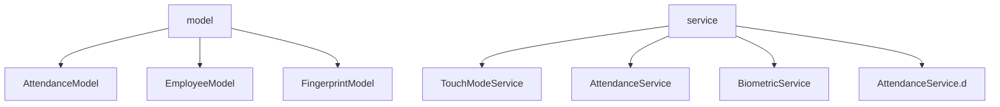

# electron-fingerprint — Arquitectura de componentes

> Diagrama generado por vault_onboard desde estructura de archivos. Verificar y ajustar.

**Lenguaje:** typescript
**Framework:** Electron

## Diagrama



## Para enriquecer

```bash
python scripts/vault_diagram_save.py --project electron-fingerprint \
  --title "Arquitectura electron-fingerprint" --type mermaid --category component \
  --content "..."
```
