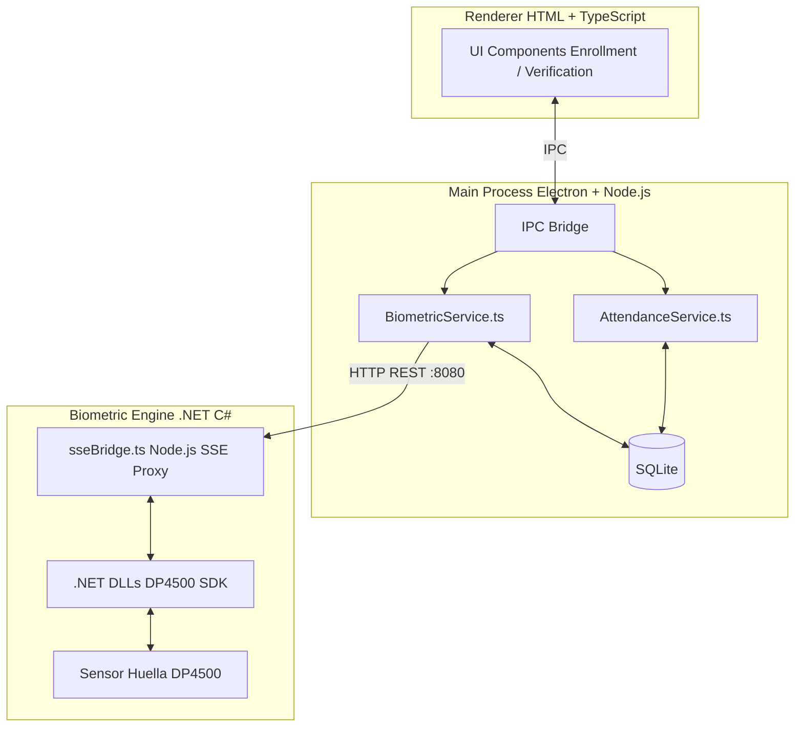

---

title: Arquitectura del Sistema

id: b7bbf8c8-59f4-4247-baf2-959d72c6b229

project: electron-fingerprint

diagramType: mermaid

category: component

createdAt: 2026-05-24T03:25:58.000Z

updatedAt: 2026-05-24T03:25:58.000Z

cia_integrity: medium

cia_availability: medium

cia_sensitivity: internal

agent: system

---

## Descripción

Arquitectura de alto nivel: Renderer HTML/TS, Main Process (Electron + services + SQLite), Motor Biometrico .NET via SSE en localhost:8080

## Diagrama

