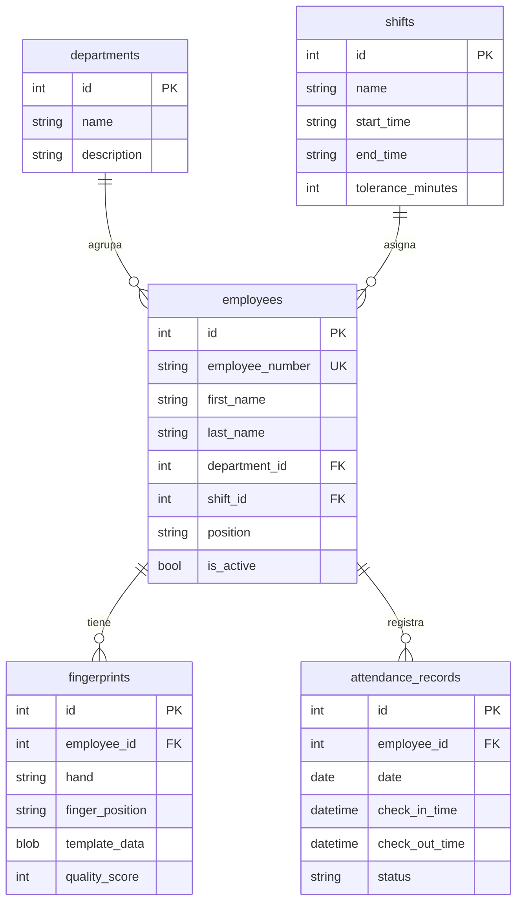

---

title: ERD Schema SQLite

id: a6b85546-6b79-4f2e-9401-2cd1d2e3705e

project: electron-fingerprint

diagramType: mermaid

category: entity

createdAt: 2026-05-24T03:27:14.000Z

updatedAt: 2026-05-24T03:27:14.000Z

cia_integrity: medium

cia_availability: medium

cia_sensitivity: internal

agent: system

---

## Descripción

Diagrama entidad-relacion del schema SQLite. 5 tablas: departments, shifts, employees, fingerprints, attendance_records. Clave: fingerprints.template_data almacena plantilla ISO base64.

## Diagrama

