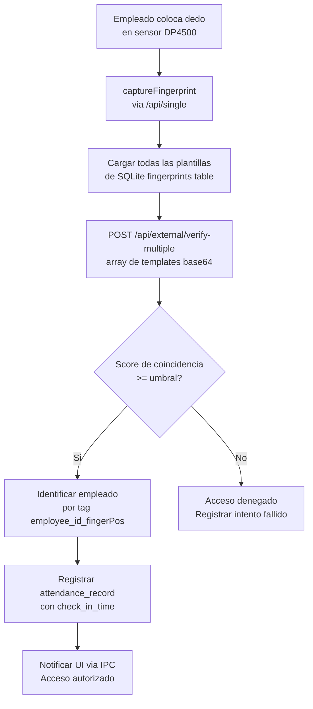

**Proyecto:** `electron-fingerprint`  |  **Tipo:** `workflow`

## Descripcion

Flujo de identificacion 1-N: el sistema captura una huella, carga todas las plantillas de SQLite, las envia al motor .NET para comparacion y registra la asistencia si hay coincidencia.

## Metadata

| Campo | Valor |
|---|---|
| **Trigger** | Empleado coloca dedo en sensor |
| **Actores** | `Empleado`, `BiometricService`, `SQLite`, `BiometricEngine .NET`, `AttendanceService` |
| **Pre-condicion** | Motor biometrico inicializado en localhost:8080, empleado enrolado con al menos una plantilla |
| **Post-condicion** | Registro de asistencia creado en attendance_records, UI notificada via IPC |

## Diagrama

